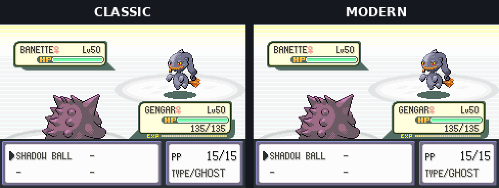
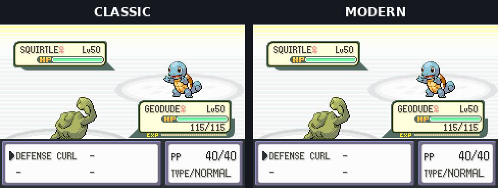
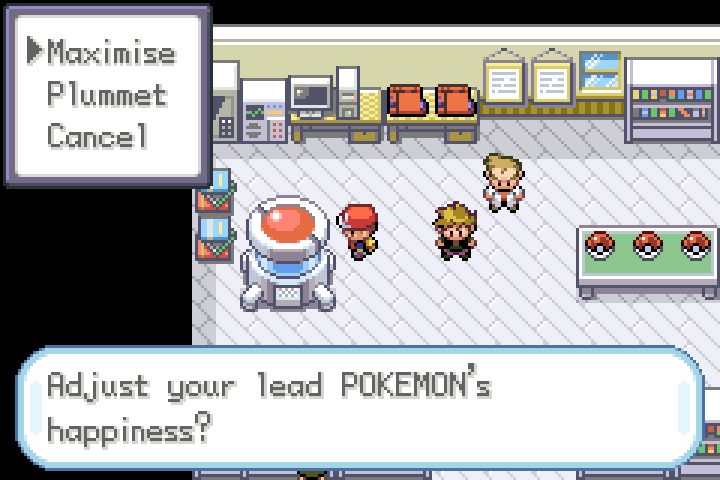
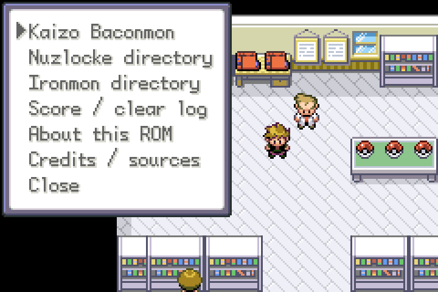
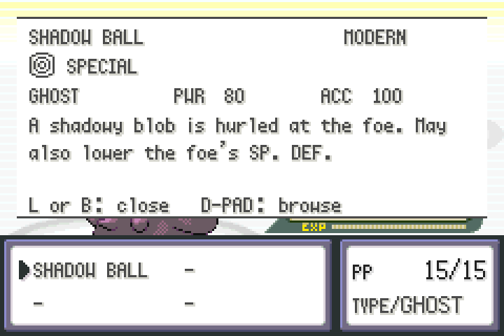

# Kaizo Baconmon

**Ironmon, but tastier.**

[Open the browser patcher](https://xbaconator9000x.github.io/Kaizo-Baconmon/)

**Current patcher: [Release build 1.0](https://github.com/xbaconator9000x/Kaizo-Baconmon/releases/latest).** Testing and feedback are ongoing; the browser randomiser is still a beta.

Kaizo Baconmon is a modular FireRed patcher and challenge toolkit, with my own take on Kaizo Ironmon as an optional full setup. I got hooked watching Ironmon VS and wanted some of those conveniences for my own runs, including playing on my phone.

I drew heavily from DrMaple's fantastic Faster FireRed 1.3.2 build. He has kindly given me permission to utilise and modify aspects of it for Baconmon.

## Babymon / evolution beta

[Open the Babymon / evolution development beta](https://xbaconator9000x.github.io/Kaizo-Baconmon/babymon-beta.html) · [Download HTML](babymon-beta.html) · [Status and checks](docs/Babymon_Beta.md)

Includes Tier 1 starters, seed-consistent Tier 1 → Tier 2 → Tier 3 randomisation, Celadon trade evolution help, direct-use evolution items and a manual Day/Night clock at the left lab computer. The clock controls evolution conditions; it is not a claim of automatic real-time lighting.

Blind starter selection, no pivoting and permadeath are player-managed rules. The game does not force blind selection or automatically end attempts. This is an experimental build; restricted TM handling, ability/move policy and separate Babymon scoring remain unfinished. Beta outputs are not certified challenge runs.

## What's it for?

It's designed with **Baconmon, Kaizo/Ironmon-style runs, VS-style challenges, ordinary Nuzlockes, and custom or casual randomised runs** in mind. You don't have to use my ruleset to use the patcher.

Use the full **Core Baconmon Package**, or pick the bits you actually want. Maybe you want Classic mechanics with a few QoL changes, Modern mechanics for a different challenge, or a score log to give you something to chase when the seed inevitably goes sideways lol.

That's why it's modular: different runs need different things. You shouldn't have to take a whole new ruleset just because you want one feature.

**This isn't standard Ironmon, and the options aren't automatically legal under another challenge's rules.** Changes like field HMs without an HM friend or Modern battle mechanics can change the challenge. Check your chosen rules before enabling anything, and keep modified runs separate from standard Ironmon results. The VS-style features are inspired by Ironmon VS, not an official VS setup.

The built-in **score log** tracks run milestones; it isn't a replacement for the external Ironmon Tracker.

## Quick start

1. Bring your own **clean US FireRed 1.1 (Rev 1)** or **Faster FireRed 1.3.2** ROM. No ROM is included here.
2. Open the browser patcher linked above in a current browser.
3. Choose your ROM, then use the **Core Baconmon Package** or select the features you want. Check your run's rules first.
4. Click **Check and apply**. Read the output log: conflicting changes may be skipped, so don't assume everything was applied.
5. Download the patched copy and start a fresh run in your emulator. Keep your original ROM and saves as backups.

Want randomised seeds? Use the optional batch randomiser after patching. It's still a beta and needs internet to load its Java runtime. For a downloadable copy of the patcher, open the release linked above and choose **Kaizo_Baconmon_Patcher_v1.0.html**; the source ZIP is for people who want the code.

[Full patching and randomiser instructions](docs/Patcher_Guide.md)

[Run settings guide](docs/Run_Settings_Guide.md)

## Classic vs Modern

Same Pokemon, levels, stats and moves in each comparison. Only the mode changes. These are controlled emulator battles; the end frames pause so you can read the result.

### Shadow Ball: Attack or Sp. Atk?

Shadow Ball is physical in Classic and special in Modern. Gengar gets a lot more out of that Sp. Atk stat.

### Sturdy gets an upgrade

Same hit, different outcome. Modern Sturdy saves a full-health Geodude from a knockout. Classic Sturdy only blocks one-hit KO moves.

## A few extras

| Happiness machine | Nuz-guide | Move details: press L |
| --- | --- | --- |
|  |  |  |
| Make your lead Pokemon like or hate you more. | Rules, challenge guides and your score log. | Check a move without leaving the battle. |

## What's included?

- **Classic / Modern:** play with the original Gen 3 battle mechanics, or use the physical/special split and updated effects for the existing abilities. Pokemon, BSTs, learnsets and available abilities stay as they were. **Note: Fairy typing is intentionally omitted.**
- **Lab start:** still choose your gender, name and rival's name, then start in Oak's lab ready to pick your starter. Get one Master Ball and five Poke Balls early.
- **Rival level:** defaults to level 8 in the lab. You can choose anything from 1 to 100 in the patcher.
- **No HM friend needed:** use field HMs without teaching them. You still need the HM, badge and normal story requirements. Fly from the Town Map too.
- **Lit Rock Tunnel:** no Flash needed to see where you're going.
- **Move relearner:** sits opposite the Move Deleter in Fuchsia. Each remembered move costs one TM of your choice.
- **Friendship controls:** use Oak's lab machine to make your lead Pokemon like or hate you more.
- **Poison-friendly forest nurse:** she heals you even if you're poisoned.
- **Early encounter rotation:** early wild encounters rotate, inspired by Ironmon VS.
- **Hidden items:** chance-based hidden items appear at their normal refresh. This doesn't make farming them legal under the rules.
- **Move information:** press L while choosing an attack for its description. Physical, special and status symbols also appear in the move screens.
- **Nuz-guide:** an in-game key item with challenge guides, the full Baconmon rules, mode details, credits and a 33-point VS-style score log.
- **Baconmon title screen:** starring Grumpig, of course.

The guide explains the full Baconmon setup. If you change the options, agree on your rules before comparing runs with someone else.

## What changes your run?

Not every convenience is just cosmetic. This is a heads-up about the differences, not a claim that a particular challenge allows them.

| Feature | What it affects |
| --- | --- |
| Modern mode | Battle mechanics: physical/special categories and effects of existing abilities. Classic keeps the original Gen 3 mechanics, but doesn't cancel other selected modifications. |
| Rival level | Opening battle difficulty and the experience available from it. |
| Lab start and early balls | Opening progression and starting resources. |
| Field HMs and Town Map Fly | Party management and field access: no HM friend needed, while HM, badge and story checks still apply. |
| Lit Rock Tunnel | Visibility and the need to use Flash for navigation. |
| TM-paid move relearner | Move access and resources: exchange a TM to relearn a move. |
| Happiness machine | Friendship, including the power of Return and Frustration. |
| Poison-friendly forest nurse | Healing access while poisoned. |
| Encounter rotation and hidden-item changes | Encounter opportunities and item availability. Your rules still determine what you may catch or collect. |
| L-button move details and category symbols | Battle information shown to the player. Check any restrictions on information aids. |
| Nuz-guide and score log | Rules reference and milestone recording; not automatic enforcement of every rule. |
| Title screen | Presentation. Grumpig isn't giving you a combat advantage lol. |
| Randomiser settings | Whatever the selected preset or settings change. Use matching settings when comparing runs. |

## Why points?

I included the VS-style points because I find tracking progress and chasing a PB more fun than only counting a Champion win. Kaizo Ironmon can take dozens, hundreds or even thousands of attempts. Points give you smaller milestones to aim for, a way to see yourself improving, and something to compete over with friends—even when nobody wins the seed.

The in-game log tracks your current run. Keep a note of your PB to compare attempts.

## How to use it

You'll need your own clean US FireRed 1.1 (Rev 1) ROM or Faster FireRed 1.3.2. Open the browser patcher linked above, choose your ROM and the features you want, then click **Check and apply**. Read the patch notes to see what worked and what was skipped.

The patcher makes a separate copy and leaves your original ROM and saves alone. The batch randomiser is a beta. Choose up to 100 ROMs per batch; large batches download in ZIP parts of up to 10 ROMs. Download each part before continuing. The randomiser needs an internet connection to load its Java runtime on first use.

[Full instructions](docs/Patcher_Guide.md)

## My optional ruleset

The full Baconmon rules are my own take, inspired by Kaizo Ironmon and Ironmon VS. They are optional; you do not need to use them to use the patcher.

I am especially interested in feedback on the rules themselves, including unclear wording, edge cases and loopholes. Please report anything reproducible with the settings and steps needed to see it.

## Known issues and testing limits

I'm new to romhack development and the Nuz-like scene generally, so feedback and guidance are very welcome! I'd especially like thoughts on the run rules and reports of anything that doesn't work properly.

Designed for maximum compatibility between ROMs. Changes that cannot be applied are skipped and listed in the output log. I can’t guarantee compatibility with any particular ROM. Designed for clean US FireRed 1.1 (Rev 1) or Faster FireRed 1.3.2; other modified ROMs may also work.

Desktop patching, upgrades, selected game features and browser seed generation have been tested. See the [test reports](reports/README.md) for what those checks actually covered.

- **Still to test:** a full playthrough and seed generation on an actual Android device.
- **Batch randomiser:** still a beta. Passing scheduling checks isn't the same as testing every large batch on real hardware.
- **Other ROM hacks:** successful patching doesn't prove the combined game is stable. Skipping a conflict also means you might not get every feature you selected.
- **External Ironmon Tracker:** compatibility hasn't been established by this documentation. Don't assume it works just because the ROM boots or because tracker reference data appears in the credits.
- **Challenge loopholes:** no dedicated exploit audit has been completed. The score log doesn't certify a legal run.
- **Existing saves:** use a fresh run when changing the setup. The patcher doesn't migrate old save data.

These are known limits of the testing, not a list of confirmed exploits. Please report anything reproducible rather than assuming it's already on the radar.

If something breaks, tell me what happened, how to reproduce it and include the patcher's detailed report. Please keep ROMs, saves and save states out of public issues.

## Changelog

### Release build 1.0

First packaged GitHub release of the modular browser patcher, with a downloadable HTML patcher and source ZIP. Includes Classic/Modern mechanics, selectable QoL features, the Nuz-guide and score log, and the beta batch randomiser.

### Documentation updates after 1.0

Clarified the supported run types, optional Baconmon setup and rules compatibility. Added a quick-start, feature-impact table and testing limits. These are documentation changes, not new gameplay features or fixes.

[Release notes and downloads](https://github.com/xbaconator9000x/Kaizo-Baconmon/releases)

## Credits

Developed by **xbaconator9000x**.

Thanks to DrMaple for Faster FireRed and permission to adapt it; iateyourpie for Ironmon; WaffleSmacker and the VS community for Ironmon VS; and UTDZac, besteon and contributors for the tracker reference data.

The browser randomiser uses UPR-ZX by Ajarmar and contributors, based on Dabomstew's randomiser, and CheerpJ by Leaning Technologies. Engine references come from pret/pokefirered. Testing uses mGBA and Rom Patcher JS, among other tools.

[Full credits and permissions](Credits_and_Permissions.md)

## Source

The patcher code, randomiser integration, tests and ROM patch data are included in this repository. This isn't a full decompilation of the game. [Developer notes](docs/Developer_Notes.md) cover rebuilding and the test reports.

The patcher software keeps its existing MIT/GPLv3 terms. The original projects keep their own terms too; their notices are included.

## Reusing my changes

You're welcome to use my original Baconmon ROM changes in your own non-commercial project. Credit **Kaizo Baconmon by xbaconator9000x** and keep the [reuse licence](LICENSE.txt) with the material. No notification or separate approval is required. Just playing privately doesn't require a credit or message.

I'd love to see what you make, and I ask that you use the work respectfully. [A note on reuse](Reuse_Statement.md) explains those personal requests; they aren't extra licence conditions.

That permission only covers rights I hold in my own contributions. Pokémon and the original game content belong to their respective rights holders. Other creators' work needs its own permission; DrMaple's permission for Baconmon doesn't automatically extend to another project. This isn't permission to distribute complete game ROMs, and it doesn't withdraw permissions already granted under other licences.

## Disclosure

I am not the best coder, and so I accessed external tools and advice to help with development. In some cases this included AI-assisted tools that helped with general guidance, coding, scripting, debugging, testing, and some text/title-screen graphics. The patcher itself was entirely created using ChatGPT with my directed input. AI useage was otherwise minimal and was not used when reasonably avoidable. I am hesitant to support the use of AI tools in any creative project. Without such tools in this case, I am not sure I would have ever figured out how to implement this project. All creative input was contributed by myself and the aforementioned sources.
